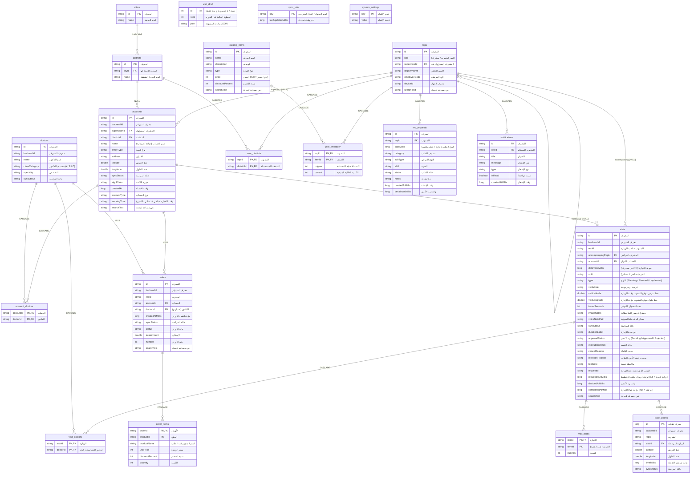

# Room database ERD

Source: `data/local/entity/*`. All dates are epoch-millis `Long`. Enums are stored as text.
Arrows: parent ||--o{ child. Delete rule shown in the label (CASCADE removes children, NULL = FK set to null).

## Notes
- A planning visit request is a `visits` row with `type = Planning` and `requestedAtMillis` not null.
- `visits.repId`, `track_points.repId`, `orders.repId`, `visits.requestId`, `visit_items.itemId` and `order_items.productId` are plain columns with no foreign key.
- `visit_draft`, `sync_info` and `system_settings` stand alone.
