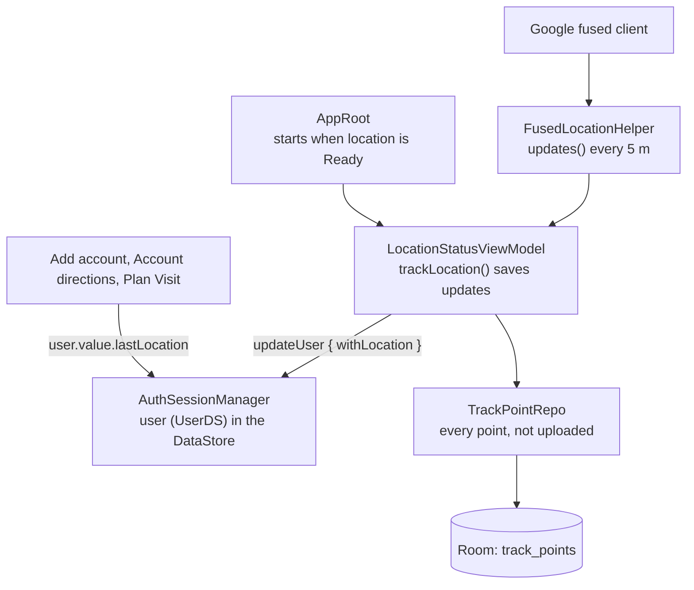

# Location flow

How the user's location moves through the app. **Keep this file up to date when the location classes change**
(`ui/common/location`, `UserLocation.kt`, `TrackPointRepo`, `AuthSessionManager.user`, and the screens that read the location).

## Steps

1. `AppRoot` runs `trackLocation()` only while the app is on the main screens and the location status is Ready (permission granted, GPS on). It is cancelled when either stops being true.
2. `FusedLocationHelper.updates()` gives a `GeoPoint` each time the phone moves about 5 m (`LocationRequest`, high accuracy, 5 s interval).
3. `LocationStatusViewModel.trackLocation()` saves every update twice:
   - as the last location, with `session.updateUser { it.withLocation(...) }` into the signed-in user kept by `AuthSessionManager` (cleared on sign-out);
   - as a track point, through `TrackPointRepo` into Room, for the signed-in rep (`session.user.value.id`). Nothing is stored when nobody is signed in; a refused insert never stops the tracking.
4. Add account, Account directions and Plan Visit read the saved location with `session.user.value.lastLocation` (`UserLocation.kt`). No screen asks the GPS directly.

`FusedLocationHelper.status()` / `statusChanges()` feed `LocationStatusViewModel` and the "location needed" dialog; they are not part of the saving flow.
